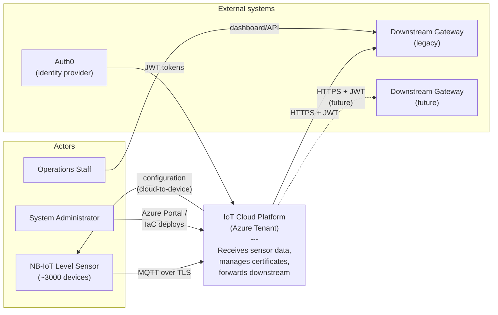
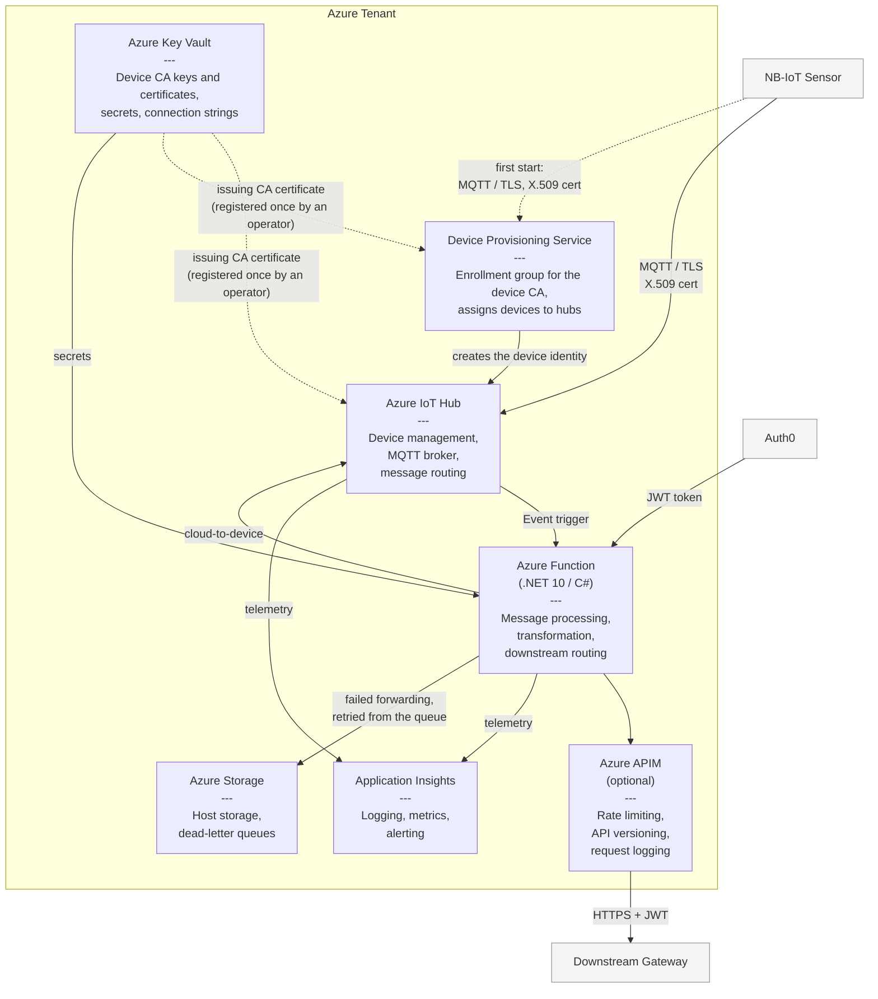
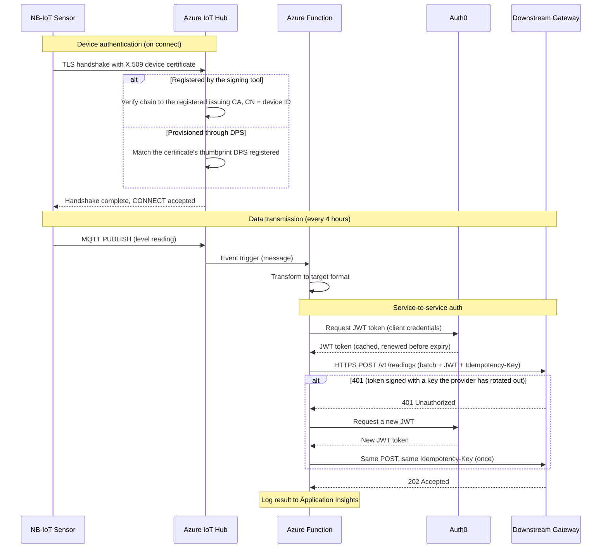
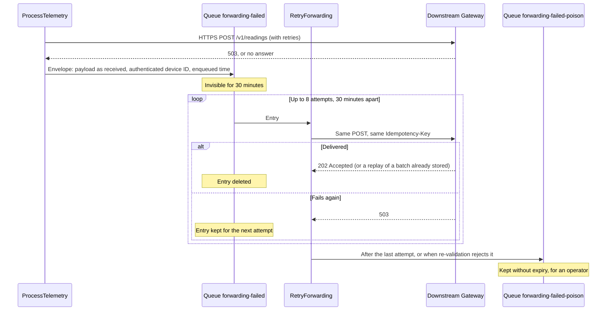
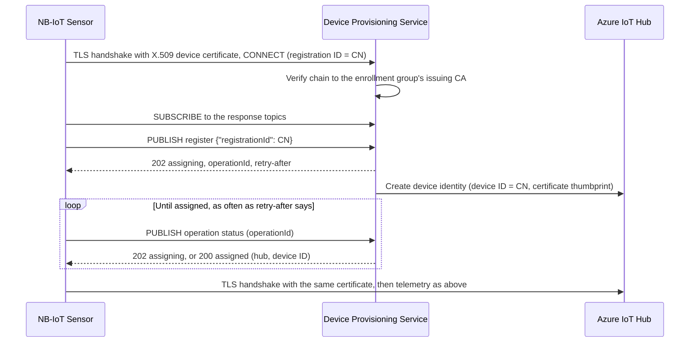
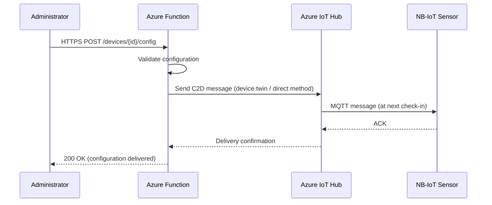

# Architecture — IoT Cloud Platform

## C4 Model

### Level 1: Context diagram

Shows the system as a whole and its relationships to external actors.



### Level 2: Container diagram

Shows the internal components of the Azure platform.



### Component responsibilities

| Component | Responsibility | Modularity |
|-----------|----------------|------------|
| **IoT Hub** | Device registry, MQTT broker, message routing, C2D messages | Replaceable by another MQTT broker — no vendor lock-in in the application layer |
| **Device Provisioning Service** | Zero-touch provisioning: authenticates a device's certificate against the enrollment group for the device CA, creates its identity in the hub it assigns, and tells the device that hub ([#48](https://github.com/asnielsen789/IIoT-platform/issues/48)) | Hubs can be linked and unlinked, an operator's own included, so devices move between hubs without being changed; devices can also be registered without it (`IIoT.DeviceCa issue --hub`) |
| **Key Vault** | The device CA's signing keys, which never leave it, and its certificates ([ADR-009](adr/adr-009-device-pki.md)); secrets for the Function. Not a CA itself: `tools/IIoT.DeviceCa` builds the certificates and has Key Vault sign them | Plain keys and RFC 5280 certificates: the keys can move to an HSM, the issuing CA to another provider |
| **Azure Function** | Core logic: receive → transform → forward. Adapter pattern downstream | Can be relocated to other infrastructure as a container or service |
| **APIM** | Optional layer for throttling, versioning and logging of outbound calls | Can be removed without affecting the Function |
| **Azure Storage** | Host storage for the Function, and the dead-letter queues `forwarding-failed` and `forwarding-failed-poison` for messages that could not be forwarded ([ADR-010](adr/adr-010-dead-letter-handling.md)) | The queues have a connection of their own, so they can move to another account; any queue with retry and poison handling could replace them |
| **Application Insights** | Observability for the whole platform | Replaceable by another monitoring solution |

---

## Sequence: sensor data to downstream gateway

Normal flow for a level reading from sensor to the downstream system.



When the gateway stays unavailable through the forwarder's retries, the message is not lost
([ADR-010](adr/adr-010-dead-letter-handling.md)). `ProcessTelemetry` writes it to a Storage queue,
and `RetryForwarding` sends it again later, through the same validation and identity check, with
the identity and receipt time of the original delivery, and so with the same body and
`Idempotency-Key`:



## Sequence: zero-touch provisioning

A device's first start when nobody has registered it
([#48](https://github.com/asnielsen789/IIoT-platform/issues/48)). The device knows the global
endpoint, the ID scope and its certificate, and DPS tells it the hub. DPS registers the device by
its certificate's thumbprint, so a renewed certificate, or a move to another hub, is another
registration ([Devices provisioned through DPS](../infra/README.md#devices-provisioned-through-dps)).



## Sequence: cloud-to-device configuration

Sending a configuration message to a device. This is planned in
[#16](https://github.com/asnielsen789/IIoT-platform/issues/16) and not implemented yet.



---

## Design decisions

### Message format

Telemetry from sensor to IoT Hub follows a versioned JSON contract. The device transmits
raw measured values; conversion to volume is a cloud responsibility, so calibration can be
corrected without an OTA campaign across the fleet.

- Contract: [`mqtt-payload.md`](mqtt-payload.md)
- Normative schema: [`schemas/telemetry-v1.schema.json`](schemas/telemetry-v1.schema.json)
- Rationale: [ADR-004](adr/adr-004-message-format.md)

### Adapter pattern for downstream integration

So that migration from a current to a future downstream interface stays cheap:

```
Azure Function
    └── IDataForwarder (interface)
            ├── GatewayV1Forwarder       ← current gateway format
            └── GatewayV2Forwarder       ← future format (backlog, not implemented)
```

Today the Function registers `GatewayV1Forwarder` directly
(`src/IIoT.Functions/ForwardingServiceCollectionExtensions.cs`). Once a second forwarder
exists, the plan is to select it by configuration (an app setting) rather than a code change,
so both can run in parallel during a transition period.

The forwarder receives the whole validated message together with a forwarding context — the
authenticated device identity and IoT Hub's enqueued time — so identity and receipt time
downstream never come from the payload. The v1 format is the platform's own, versioned
independently of the device contract:

- Contract: [`gateway-contract.md`](gateway-contract.md)
- Normative schema: [`schemas/gateway/readings-v1.schema.json`](schemas/gateway/readings-v1.schema.json)
- Reference receiver: [`tools/IIoT.GatewayMock`](../tools/IIoT.GatewayMock/README.md)

### Modularity for hand-over

Components are designed so that an operator can take over parts of the platform:

```
          Can be relocated
                   │
    ┌──────────────┼──────────────┐
    ▼              ▼              ▼
 Function     APIM policies   Auth0 config
(container)   (export/import)  (tenant transfer)
    │
    └── IoT Hub remains in the platform tenant
        (or is migrated separately)
```

Devices that provisioned through DPS can be handed to an operator's own hub without being changed:
the operator's hub is linked to the platform's DPS, the enrollment is pointed at it, and each
device moves the next time it registers
([Moving devices to another hub](../infra/README.md#moving-devices-to-another-hub); not tested
yet).
